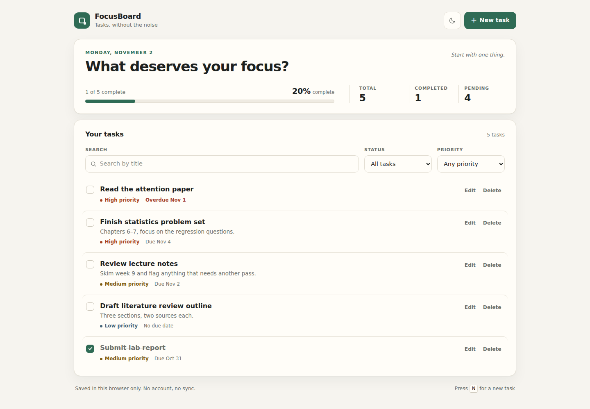
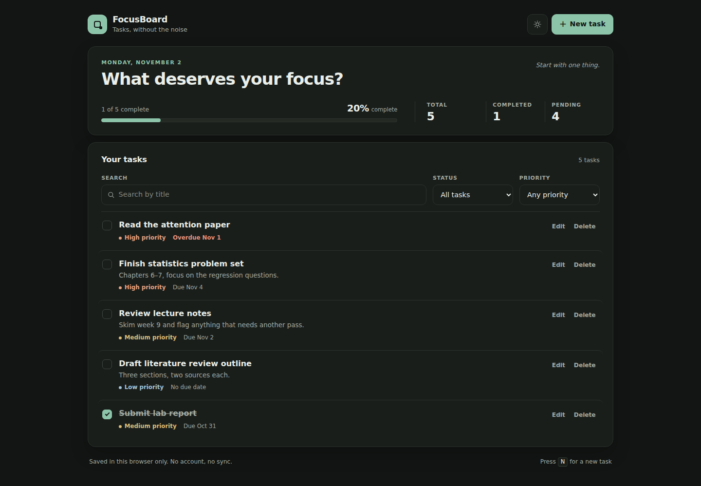
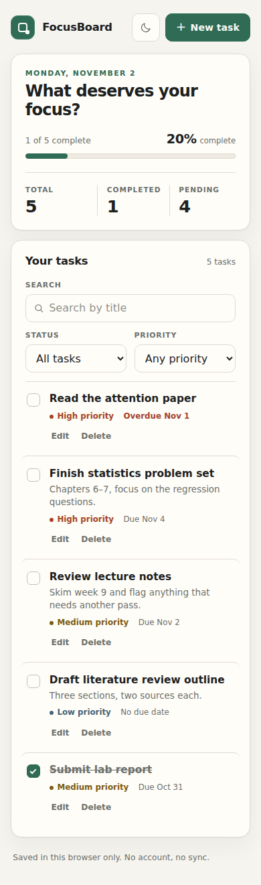

# FocusBoard

A lightweight personal task and study dashboard for planning a focused day. Add tasks, set priorities and due dates, filter what matters, and watch your completion progress — all in a single page with no account required.


## Overview

FocusBoard keeps the task workflow deliberately small: capture a task, decide how urgent it is, and work through it. Everything is stored in the browser's `localStorage`, so the app works offline after the first load and never sends task data anywhere.

The interface is mobile-first and built around a quiet, paper-like palette with a light and dark theme. Completed tasks move below pending ones, and the overview panel keeps totals and completion percentage in view.

## Features

- **Task management** — add tasks with a title, optional description, priority (low, medium, high), and optional due date.
- **Edit and delete** — update any task from an accessible dialog; delete with a confirmation step.
- **Complete and reopen** — toggle a task between pending and completed with a keyboard-friendly checkbox.
- **Filtering** — filter by status (all, pending, completed) and priority.
- **Title search** — case-insensitive search across task titles.
- **Progress overview** — total, completed, and pending counts plus a completion percentage and progress bar.
- **Due date awareness** — overdue tasks are labelled clearly in each row.
- **Local persistence** — tasks and the chosen theme survive refreshes. Corrupted or unavailable storage is handled without breaking the app.
- **Light/dark theme** — follows the system preference on first visit and remembers an explicit choice.
- **Thoughtful empty states** — separate guidance for a brand-new board and for filters that match nothing.
- **Input validation** — required titles, length limits, and real calendar-date checks, with inline messages and `aria-invalid` states.
- **Responsive and accessible** — semantic HTML, labelled controls, visible focus rings, a skip link, and keyboard support.

## Tech stack

| Layer | Choice |
| --- | --- |
| Markup | Semantic HTML5 |
| Styling | Hand-written CSS3 (custom properties, mobile-first) |
| Application | TypeScript, compiled by Vite |
| Build tool | Vite |
| Storage | Browser `localStorage` |
| Tests | Vitest (unit) and Playwright (browser) |
| Backend | None |
| Paid services | None |

## Project structure

```text
.
├── .github/workflows/
│   ├── ci.yml                 # type-check, unit tests, browser tests, build
│   └── pages.yml              # build and deploy to GitHub Pages
├── docs/screenshots/          # actual desktop and mobile captures
├── index.html                 # semantic app shell and task dialog
├── src/
│   ├── main.ts                # DOM rendering and event wiring
│   ├── types.ts               # Task, filters, stats, theme types
│   ├── tasks.ts               # pure validation and task operations
│   ├── storage.ts             # safe localStorage read/write
│   ├── styles.css             # responsive light/dark theme
│   ├── tasks.test.ts          # task operation tests
│   └── storage.test.ts        # persistence and corruption tests
├── tests/e2e/
│   ├── app.spec.ts            # core user flows and persistence
│   ├── accessibility.spec.ts  # axe scans
│   ├── responsive.spec.ts     # 390 / 768 / 1440 px layouts
│   ├── screenshots.spec.ts    # deterministic screenshot capture
│   └── helpers.ts
├── LICENSE
├── playwright.config.ts       # production-preview browser tests
├── README.md
├── tsconfig.json              # strict TypeScript
└── vite.config.ts             # Pages base path + Vitest config
```

The split is intentional: `tasks.ts` contains no DOM or storage access, which keeps the business rules easy to test; `storage.ts` isolates all browser persistence; `main.ts` owns rendering and events.

## Getting started

### Prerequisites

- Node.js 20 or newer
- npm 10 or newer

### Setup

```bash
git clone https://github.com/bigearner852/Focus-Board.git
cd Focus-Board
npm install
npm run dev
```

Vite prints a local URL (by default `http://localhost:5173`). Open it in a browser.

## Commands

| Command | Purpose |
| --- | --- |
| `npm run dev` | Start the development server with hot reload. |
| `npm run typecheck` | Run `tsc --noEmit` with strict settings. |
| `npm test` | Run the Vitest unit suite once. |
| `npm run test:watch` | Run unit tests in watch mode. |
| `npm run test:e2e` | Build, serve, and run the Playwright suite in Chromium. |
| `npm run screenshots` | Regenerate the README screenshots from seeded data. |
| `npm run build` | Type-check, then produce a production build in `dist/`. |
| `npm run preview` | Serve the production build locally. |

Browser tests need Chromium once per machine:

```bash
npx playwright install --with-deps chromium
```

## Data and privacy

- Tasks are stored under the key `focusboard.tasks.v1` and the theme under `focusboard.theme`.
- Nothing is sent to a server; clearing site data removes the board permanently.
- If storage is blocked or full, changes remain usable for the session and the app announces that they could not be saved.
- On load, stored data is validated field by field. Malformed JSON, non-array payloads, duplicate IDs, invalid priorities, and impossible dates are discarded or repaired rather than crashing the app.

## Demo

A hosted demo is not live yet because GitHub Pages is not enabled for this
repository; see [Production build and deployment](#production-build-and-deployment)
for the one-time setup. To run the app locally:

```bash
npm install
npm run dev
```

The app starts empty. Add a task with the **New task** button (or press `N`), then try the status and priority filters, title search, theme toggle, and reload the page to confirm your data is still there.

## Testing

### Unit tests

```bash
npm test
```

The 33 Vitest tests cover:

- draft validation (empty/long titles, bad priorities, impossible dates)
- task creation, updates, toggling, and removal
- status/priority filtering, title search, and combined filters
- sorting order and stats/percentage calculations
- overdue detection against the local calendar date
- persistence round-trips and theme storage
- corrupted JSON, malformed entries, duplicate IDs, and throwing storage implementations

### Browser tests

```bash
npx playwright install --with-deps chromium
npm run test:e2e
```

The 20 Playwright tests run against the production preview and cover:

- add, validate, edit, delete, complete, and reopen flows
- status/priority filters, title search, and overdue labels
- theme switching and persistence after reload
- `N` and `Escape` keyboard behavior, including focus restoration
- task persistence after a full page reload and delete confirmation
- 390px, 768px, and 1440px layouts with horizontal-overflow checks
- axe accessibility scans of the board and the task dialog

## Production build and deployment

```bash
npm run build
npm run preview
```

Pushes to `main` run `.github/workflows/pages.yml`, which builds with
`VITE_BASE_PATH=/Focus-Board/`, uploads `dist/`, and deploys to GitHub Pages.
Local builds default to a relative base so `dist/` also works from any static
subdirectory.

GitHub Pages must be enabled once before the deploy job can publish:

1. Open **Settings → Pages** in the repository.
2. Under **Build and deployment**, set **Source** to **GitHub Actions**.
3. Re-run the latest **Deploy to GitHub Pages** workflow, or push to `main`.

The expected URL is <https://bigearner852.github.io/Focus-Board/>. It was not
live at the time of the v0.1.0 verification because the available GitHub token
could not create the Pages site.

## Screenshots

All screenshots below are real captures of the production build, generated by
`npm run screenshots` at 1440×900 (desktop) and 390×844 (mobile).

| Desktop — light | Desktop — dark |
| --- | --- |
|  |  |



To refresh them after a UI change, run `npm run screenshots`; the Playwright
spec seeds the sample tasks and writes the three PNGs into
`docs/screenshots/`.

## Accessibility

- Semantic landmarks (`header`, `main`, `footer`, `section`), a skip link, and one `h1`.
- All form controls have associated labels; validation errors are connected with `aria-describedby` and announced via a live region.
- The task dialog is a native `<dialog>` with a labelled heading and Escape-to-close behaviour.
- Closing the dialog returns focus to the control that opened it, with a safe fallback if that control no longer exists.
- Custom checkboxes retain native keyboard behaviour and expose descriptive labels.
- Focus is never removed visually, and edit/delete actions remain reachable by keyboard on every viewport.
- Theme contrast and touch targets are sized for small screens; the layout respects reduced-motion preferences.
- Automated axe scans of the board and the dialog are part of the Playwright suite and must report no serious or critical issues.

## Keyboard shortcuts

| Key | Action |
| --- | --- |
| `N` | Open the new-task dialog when focus is not inside a form control. |
| `Tab` / `Shift+Tab` | Move through toolbar, tasks, and dialog controls. |
| `Escape` | Close the task dialog and return focus to its trigger. |
| `Enter` / `Space` | Toggle a focused task checkbox or activate a button. |

## Browser support

Current versions of Chrome, Edge, Firefox, and Safari. The app relies on modern CSS custom properties, `color-mix()`, and the native `<dialog>` element.

## Limitations

- Data is per browser profile and device; there is no sync, export, or import.
- No due-date reminders or notifications.
- Search covers task titles only, as specified.
- Browser tests run in Chromium; other browsers are supported by the standards used but are not part of automated CI.
- The GitHub Pages deploy workflow is committed and the base path is verified locally, but the hosted demo awaits a repository admin enabling Pages.

## License

[MIT](LICENSE)
